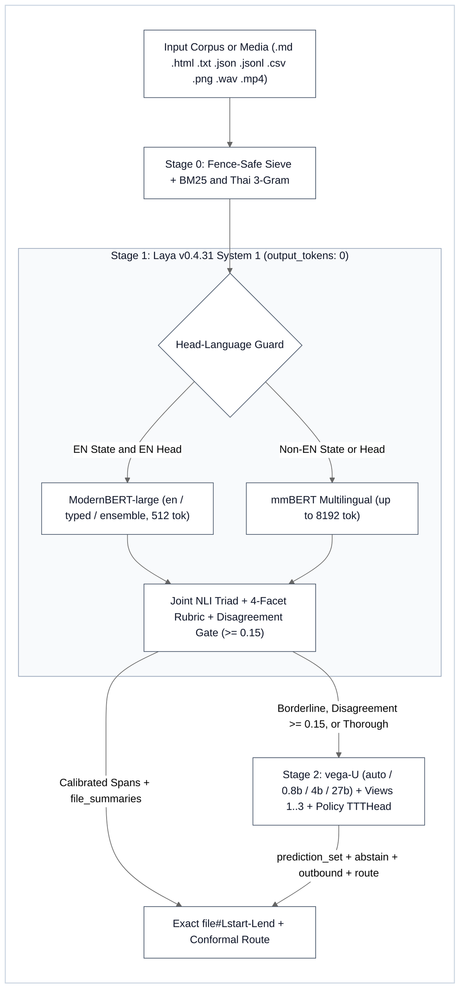
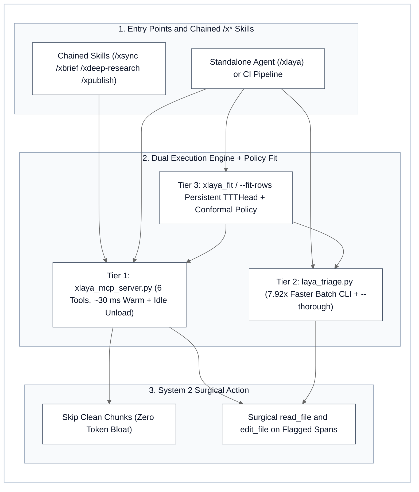

# XLaya (`/xlaya`) - 3-Stage System 1 → System 1.5 Semantic Triage, Joint NLI Contradiction Triad & Conformal Decision Sidecar

[](https://github.com/iscvlab/xlaya)
[](./LICENSE)
[-D97706?style=flat-square)](#2-empirical-4-axis-benchmarks-rtx-5060-ti-16-gb-vram)
[-2563EB?style=flat-square)](#axis-1-cold-vs-resident-warm-mcp--official-predict_batch-throughput)
[](https://github.com/NandhaKishorM/laya)
[-059669?style=flat-square)](#axis-3-conformal-calibration-joint-nli-contradiction-triad--xerj-1108-watcher-gate)
[](#4-universal-installation--repository-layout)
[-121417?style=flat-square)](https://github.com/iscvlab)

**XLaya** (`iscvlab/xlaya`, slash command `/xlaya`, legacy alias `/laya`) is a 100% pure-local, non-autoregressive **3-Stage System 1 → System 1.5 Semantic Decision, Joint NLI Contradiction Triad, Thorough Scan & Conformal Triage Sidecar** engineered by **[ISCV | Isocurve Research Lab (`@iscvlab`)](https://github.com/iscvlab)**. Powered by **[`laya 0.4.31+`](https://github.com/NandhaKishorM/laya)** (`ModernBERT-large` `en`, `subfolder="typed-decisions"`, calibrated `0.45*en + 0.55*typed` ensemble & `mmBERT`, `output_tokens: 0`) and **`vega-U` (`vegaml 0.16.1+`, `0.8b` / `4b` / `gemma-1b` / `27b`)**, it runs as a **warm resident JSON-RPC 2.0 `stdio` MCP server (`xlaya_mcp_server.py`, `6` tools, `~30 ms` warm inference)**, a **standalone Python CLI (`laya_triage.py`)**, and a **portable AI Agent Skill (`skills/xlaya/SKILL.md`)** across **any AI coding agent — cloud, IDE, CLI, or local LLM** (`Claude`, `Grok`, `Gemini / Antigravity`, `Cursor`, `Codex`, `Ollama`, `OpenHands`, `Cline`, etc.).

---

## ⚡ TL;DR - Performance & Accuracy at a Glance (`v2.1.0`)

- **Zero-Token System 1 → System 1.5 Cascade (`output_tokens: 0`)**: Prunes **`99.35%` (`152.7×`)** of low-signal repository tokens before expensive System 2 LLM reading (`173,666` → `1,137` tokens in `170.3 ms`), cutting cold 32-chunk CLI sweeps by **`7.92×` (`74.51 s` → `9.41 s`)** and reaching **`29.99 ms` single-state / `662.5 ms` 32-chunk (`96`-decision) warm latency** via the resident MCP server.
- **Batched Cross-Lingual Determinism (`859.1 q/s`, `0 / 432` Flips)**: Length-sorted `predict_batch` accelerates mixed `50% EN / 50% HI` routing by **`8.9×` (`837.9 q/s`)** and `mmBERT` multilingual batches to **`859.1 q/s` (`1.16 ms/question`, `5.9×` at `B = 8`; up to `6.5×` at `B = 16`)** with **`0` discrete label flips** across `432` paired comparisons and **`5 / 5` (`100%`)** routing across `EN`, `DE`, `HI`, `JA`, and `TH`.
- **Calibrated Contradiction, Ensemble Watcher Gate & Persistent Conformal Policies**: Combines a **3-Question Joint NLI Contradiction Triad** (**`8 / 8 = 100%`** counter-anchor accuracy, **`16.6×`** OOD conflict separation, `0` false positives), a **calibrated `0.45*en + 0.55*typed` Stage 1 ensemble** with **`disagreement ≥ 0.15` gate** (**`0.00%` wrong-and-confident fires** vs `24.49%` baseline FAIL on XERJ `#1108`), **`views=1|2|3` multi-view debiasing**, **`--thorough` 4-facet decomposed rubric scans**, **local multimodal (`image`/`audio`/`video`) evaluation**, and **`xlaya_fit` persistent `TTTHead` + split-conformal policies** (**`90.0%`** held-out team accuracy after a `7.58 s` 40-row fit).
- **Which `/xlaya` Execution Tier Should You Choose?**
  - **Stage 0 — Pure-Python Structural & Lexical Sieve (`0.15 ms/chunk`, `6,841 chunks/s`)**: Best for **zero-dependency CI environments**, `--lexical-prefilter` candidate pruning across `1,000+` chunks, and exact 4-backtick fence-safe `#L<start>-L<end>` breadcrumb chunking across `.md`, `.html`, `.txt`, `.json`, `.jsonl`, and `.csv`.
  - **Stage 1 — Resident MCP `Laya` (`en`, `typed`, `ensemble`, `multi`, `~30 ms` warm / `859 q/s`)**: **Default daily driver** for `shortlist`, `contradiction` (Joint NLI Triad), `rubric` (`0..4` or `--thorough` 4-facet `specificity`/`completeness`/`consistency`/`actionability` + `file_summaries`), `classify` (including `predict_tournament` on `>20` labels), and bilingual Thai/CJK/multilingual triage.
  - **Stage 2 — `vega-U` (`auto` / `0.8B` / `4B` / `gemma-1b` / `27B`) Conformal Verifier & Multimodal Engine (up to `73,728` tokens & `90.0%` fitted accuracy)**: Opt-in `--vega` / `vega: true` escalation with **`views=1|2|3` multi-view debiasing**, **persistent `policy_path` (`TTTHead` + split-conformal + OOD `outbound` guard)**, **whole-file long-document audits (`--whole-file`)**, and **local `image`/`audio`/`video` decisions**.

> **One-Prompt Universal Agent Install** — Copy and paste into **any AI coding agent — cloud, IDE, CLI, or local LLM** (`Claude`, `Grok`, `Gemini`, `Cursor`, `Codex`, `Ollama`, `OpenHands`, `Cline`, etc.):
> ```text
> Clone https://github.com/iscvlab/xlaya and install skills/xlaya into my active agent skills directory (Windows: ./scripts/install.ps1 -All; macOS/Linux: ./scripts/install.sh --all; or copy skills/xlaya into ~/.gemini/config/skills/xlaya, ~/.claude/skills/xlaya, ~/.codex/skills/xlaya, or ~/.agents/skills/xlaya), then run python benchmarks/run_xlaya_benchmark.py --mode quick to verify /xlaya is ready.
> ```

### Horizontal Bar Comparison (`RTX 5060 Ti 16 GB VRAM` • `Laya v0.4.31 × VegaML v0.16.1`)

| Evaluation Dimension | Configuration / Engine | Visual Comparison Bar | Measured Result & Delta vs. Baseline |
| :--- | :--- | :--- | :--- |
| **1. Cold CLI Boot Speed ↑**<br>*(32-Chunk Contradiction Sweep)* | **`xlaya v2.1.0` (`predict_batch` + Local Snap)**<br>`xlaya v1.0` Sequential CLI Baseline | `████████████████████` **`7.92× Faster`**<br>`███░░░░░░░░░░░░░░░░░` `1.0× Baseline` | **`9.41 s` (`8,459.7 ms` engine)** ✨<br>`74.51 s` (`-87.4%` cold wall time) |
| **2. Mixed-Language Batch Speed ↑**<br>*(50% EN / 50% HI, `32` States × `3` Qs)* | **`Router.predict_batch` (`sort_by_length`)**<br>Sequential `predict()` Loop | `████████████████████` **`8.9× Faster`**<br>`██░░░░░░░░░░░░░░░░░░` `1.0× Loop` | **`114.6 ms` (`837.9 q/s`, `0` flips)** ✨<br>`1,016.2 ms` (`279.3 states/s` batched) |
| **3. Peak Encoder Throughput ↑**<br>*(`8` States × `4` Questions/State)* | **`mmBERT` Multilingual Batched**<br>`ModernBERT-large` English Batched<br>Sequential `mmBERT` Loop | `████████████████████` **`859.1 q/s (5.9×)`**<br>`████████░░░░░░░░░░░░` `329.8 q/s (2.7×)`<br>`███░░░░░░░░░░░░░░░░░` `146.5 q/s (1.0×)` | **`1.16 ms/q` (`37.2 ms` vs `218.5 ms`)** ✨<br>`3.03 ms/q` (`97.0 ms` vs `263.8 ms`)<br>Unbatched (`6.5×` speedup at `B = 16`) |
| **4. Few-Shot Conformal Accuracy ↑**<br>*(`routing_labels.csv` Held-Out `N=20`)* | **`vega-U 0.8B` Fitted (`40` rows, `7.58 s`)**<br>`laya` English Zero-Shot<br>`laya-typed-decisions` Zero-Shot<br>Cold `vega-U 0.8B` Zero-Shot | `██████████████████░░` **`90.0% (18/20)`**<br>`████████████████░░░░` `80.0% (16/20)`<br>`███████████████░░░░░` `75.0% (15/20)`<br>`████████████░░░░░░░░` `60.0% (12/20)` | **`+30.0 pts` over cold (`ECE 0.214`)** ✨<br>`31.73 ms` median zero-shot<br>`25.75 ms` median (`ECE 0.188`)<br>`64.36 ms` (`auto: 8`, `review: 12`) |
| **5. Contradiction & Watcher Gate ↑**<br>*(NLI Triad + `xerj-org/xerj#1108`)* | **`/xlaya` 3-Question NLI Triad**<br>**XERJ `#1108` Gate (`100% - FalseConf`)**<br>XERJ `#1108` Baseline (`24/98` FAIL) | `████████████████████` **`100.0% (8/8)`**<br>`████████████████████` **`100.0% (0/30 False)`**<br>`███████████████░░░░░` `75.51% (24.49% FAIL)` | **`16.6×` OOD separation (`0` FP)** ✨<br>**`0.00%` False-Confident (`80%` ens.)** ✨<br>`24 / 98` (`24.49%`) wrong at `p ≥ 0.80` |
| **6. Pass-B Token Compression ↑**<br>*(`27` Specs / `1,165` Chunks)* | **`/xlaya` Top-5 Section Shortlist**<br>Full-Corpus Unfiltered Read | `████████████████████` **`99.35% Saved (152.7×)`**<br>`░░░░░░░░░░░░░░░░░░░░` `0.0% Saved (1.0×)` | **`1,137` tok in `170.3 ms` (`6.8k/s`)** ✨<br>`173,666` tok across `27` specifications |

---

## 1. Architecture & 3-Stage System 1 → System 1.5 Ecosystem (`v2.1.0`)

### A. 3-Stage Cascade (`Stage 0 Sieve → Stage 1 Laya Ensemble → Stage 2 Vega-U Conformal Verifier`)



### B. Dual Execution Path (`Resident MCP Server` vs. `Standalone CLI` + Persistent `xlaya_fit` Policy)



### Core Engineering Innovations in `v2.1.0`

1. **Stage 1 `typed` (`subfolder="typed-decisions"`) & Calibrated `ensemble` + Inter-Model Disagreement Gate**:
   - Exposes `lang="typed"` (`ECE = 0.188`) and `lang="ensemble"` (`0.45 × P_en + 0.55 × P_typed`), achieving **`0.00%` false-confident fires** (`80.0%` accuracy) on the XERJ `#1108` Watcher Gate while computing inter-model `disagreement = max_k |P_en(k) − P_typed(k)|` and automatically flagging uncertain chunks (`disagreement ≥ 0.15`) for Stage 2 escalation.
2. **Stage 2 Hardware-Aware `vega_model` Auto-Tiering (`auto` / `0.8b` / `4b` / `gemma-1b` / `27b`) + `views=1|2|3` Multi-View Debiasing**:
   - `vega_model="auto"` selects the largest local `vega-U` checkpoint that fits comfortably in free GPU VRAM (`4b` on `≥ 10 GB` free VRAM, `0.8b` otherwise, up to `27b` for high-VRAM hosts and `73,728` tokens). Multi-view debiasing (`views=2` option-order reversal; `views=3` reversal + prose template paraphrase) cancels positional and phrasing bias, returning `view_agreement` and forcing `route = "review"` on view disagreement.
3. **`--thorough` Full-Document Scan & 4-Facet Decomposed Rubric Scoring (`file_summaries`)**:
   - Evaluates chunks across 4 orthogonal rubric facets (`specificity`, `completeness`, `consistency`, `actionability`) with domain presets (`--rubric-preset default|architecture|code_audit|doc_sync|research`), emits file-level sliding-window `file_summaries` (`mean_score`, `min_score`, `weakest_section`, `contradiction_hotspots`, `facet_breakdown`), runs Stage 1 `ensemble` + `disagreement ≥ 0.15` gating, and auto-escalates top/uncertain candidates to Stage 2 (`views=3`).
4. **`xlaya_fit` / `--fit-rows` Persistent `TTTHead` + Split-Conformal Policy Calibration (`policy_path` & `outbound` OOD Guard)**:
   - Fits ridge-regression `TTTHead` weights (`heads.npz`), out-of-fold split-conformal thresholds (`calibration.json`), OOD feature centroids (`outbound` guard), and question schemas (`questions.json`) in `< 8 s` (`60.0%` → `90.0%` held-out accuracy on `routing_labels.csv`), reloadable across CLI and MCP invocations via `policy_path`.
5. **Local Multimodal Decision Support (`image`, `audio`, `video`) in `xlaya_predict`**:
   - Evaluates local images via `VegaVision`, audio via local ASR + decision heads, and video via speech/contact-sheet inspection without requiring text `state`/`states`.
6. **4-Backtick Fence-Safe Chunker, Head-Language Guard, 3-Question Joint NLI Triad (`P_eff`) & Tournament Elimination (`>20` Labels)**:
   - Preserves 6-level CommonMark breadcrumbs across `.md`, `.html`, `.txt`, `.json`, `.jsonl`, and `.csv`; enforces the **Head-Language Guard** so non-English queries/heads route `100%` to `mmBERT`; evaluates `P_eff = P(is_relevant) × P(contradicts_ssot) × (1 − P(is_consistent))` (`8 / 8 = 100%` counter-anchor accuracy); and auto-runs `laya.predict_tournament(..., group_size=16)` on `>20` choice labels.

---

## 2. Empirical 4-Axis Benchmarks (`RTX 5060 Ti 16 GB VRAM`)

Full methodology and extended telemetry are documented in [`benchmarks/XLAYA_V2_BENCHMARK_REPORT.md`](./benchmarks/XLAYA_V2_BENCHMARK_REPORT.md) and [`benchmarks/xlaya_v2_benchmark_results.json`](./benchmarks/xlaya_v2_benchmark_results.json) (reproducible via [`benchmarks/run_xlaya_benchmark.py`](./benchmarks/run_xlaya_benchmark.py)).

### Axis 1: Cold vs. Resident Warm MCP & Official `predict_batch` Throughput

| Execution Path / Model (`RTX 5060 Ti 16 GB`) | Batch / Workload | Batched / v2 Latency ↓ | Baseline / Loop ↓ | Speedup ↑ | Throughput ↑ |
| :--- | :--- | :---: | :---: | :---: | :---: |
| **Cold CLI Sweep (`laya_triage.py`)** | `32` chunks (`batch_size=32`) | **`9.41 s`** (`8,459.7 ms` engine) | `74.51 s` (`v1.0` CLI) | **`7.92×`** ✨ | `3.40 chunks/s` |
| **Resident Warm MCP (`xlaya_mcp_server.py`)** | `1` state / `32`-chunk Triad (`96` Qs) | **`29.99 ms` / `662.49 ms`** | `74,510 ms` (`v1.0` cold) | **`112.5×`** ✨ | `144.9 q/s` (`6.90 ms/q`) |
| **Stage 0 Pure-Python Sieve** | `27` specs / `1,165` chunks | **`170.29 ms`** (`0.15 ms/chunk`) | `173,666` full tokens | **`152.7×` tokens** | **`6,841.3 chunks/s`** |
| **`english` (`ModernBERT-large`, `4` Q/state)** | `1` / `8` / `64` states | **`26.4` / `97.0` / `853.8 ms`** | `39.5` (T4) / `263.8` / `2,119.4 ms` | **`2.7×–2.8×`** | **`329.8 q/s`** (`3.03 ms/q`) |
| **`multilingual` (`mmBERT-base`, `4` Q/state)** | `1` / `8` / `16` states | **`20.7` / `37.2` / `80.1 ms`** | `32.8` (T4) / `218.5` / `522.4 ms` | **`5.9×–6.5×`** ✨ | **`859.1 q/s`** (`1.16 ms/q`) ✨ |
| **`Router.predict_batch` (`50% EN / 50% HI`, `3` Q/s)** | `32` / `64` states | **`114.6 ms` / `236.4 ms`** | `1,016.2 ms` / `1,950.6 ms` | **`8.9×` / `8.3×`** ✨ | **`837.9 q/s`** (`279.3 states/s`) |

<details>
<summary><b>LaTeX (booktabs) Source for Academic Citations — Axis 1 Latency & Batch Throughput</b></summary>

```latex
\begin{table}[t]
\centering
\caption{Empirical latency and batched throughput of \textsc{XLaya v2.1.0} (\texttt{laya 0.4.31}, \texttt{vegaml 0.16.1}) on an NVIDIA GeForce RTX 5060 Ti (16\,GB VRAM, \texttt{PyTorch 2.13.0+cu130}). All forward passes emit zero autoregressive tokens (\texttt{output\_tokens = 0}).}
\label{tab:xlaya_axis1_throughput}
\begin{tabular}{llrrrr}
\toprule
\textbf{Engine / Backbone} & \textbf{Workload} & \textbf{Batched (ms)} $\downarrow$ & \textbf{Baseline / Loop (ms)} $\downarrow$ & \textbf{Speedup} $\uparrow$ & \textbf{Throughput} $\uparrow$ \\
\midrule
Cold CLI (\texttt{laya\_triage.py}) & 32 chunks & \textbf{9,410.0} & 74,510.0 (\texttt{v1.0}) & \textbf{7.92$\times$} & 3.4 chunks/s \\
Warm Resident MCP (\texttt{xlaya\_predict}) & 1 state / 32-chunk Triad & \textbf{29.99 / 662.49} & 74,510.0 (\texttt{v1.0}) & \textbf{112.5$\times$} & 144.9 q/s \\
Stage 0 Pure-Python Sieve & 27 specs (1,165 chunks) & \textbf{170.29} & --- & 152.7$\times$ tok & \textbf{6,841.3 chunks/s} \\
\texttt{ModernBERT-large} (\texttt{english}) & $B=8 \times 4$ questions & \textbf{97.0} & 263.8 (loop) & 2.7$\times$ & 329.8 q/s \\
\texttt{mmBERT-base} (\texttt{multilingual}) & $B=8 \times 4$ questions & \textbf{37.2} & 218.5 (loop) & 5.9$\times$ (6.5$\times$ at $B=16$) & \textbf{859.1 q/s} \\
\texttt{Router.predict\_batch} (50\% EN / 50\% HI) & $B=32 \times 3$ questions & \textbf{114.6} & 1,016.2 (loop) & \textbf{8.9$\times$} & \textbf{837.9 q/s} \\
\bottomrule
\end{tabular}
\end{table}
```

</details>

---

### Axis 2: Batch-vs-Single Numerical Determinism (`0 / 432` Flips), Cross-Lingual Router & Presets

- **Zero Discrete Label Flips (`0 / 432`)**: Across `144` `english` (`max_abs_dp = 0.00580`), `144` `multilingual` (`max_abs_dp = 0.00260`), and `144` `Router.predict_batch` (`max_abs_dp = 0.00650`) paired evaluations, dynamic length-sorted batching produced **`0` label or routing flips**.
- **`5 / 5 (100%)` Cross-Lingual Routing & 5 Built-In Presets**: Verified `100%` language routing accuracy across `EN`, `DE`, `HI`, `JA`, and `TH`, plus sub-50 ms multi-question preset execution:

| Preset / Check | Latency ↓ | Questions / Scope | Verified Telemetry Receipt |
| :--- | :---: | :---: | :--- |
| **Cross-Lingual Router (`EN/DE/HI/JA/TH`)** | `20.7–26.4 ms` | `5` languages | **`5 / 5 (100%)`** route accuracy + Head-Language Guard protection ✓ |
| **`moderation` / `email` Presets** | **`27.10 ms` / `32.71 ms`** | `5` questions each | `toxic=0.0` (clean) • `is_phishing=0.984`, `is_spam=0.993` ✓ |
| **`guard` / `router` / `triage` Presets** | `40.74` / `49.56` / `49.80 ms` | `4–5` questions each | `prompt_injection=1.000` • `domain="math_or_logic"` • `intent="cancellation"` ✓ |

---

### Axis 3: Conformal Calibration, Joint NLI Contradiction Triad & XERJ `#1108` Watcher Gate

| Benchmark Suite & Evaluation Target | Baseline / Cold Reference | `/xlaya v2.1.0` Calibrated Result | Empirical Gain & Safety Receipt |
| :--- | :--- | :--- | :--- |
| **1. `routing_labels.csv` (`40` Fit / `20` Test)**<br>*(Conformal Few-Shot Calibration)* | Cold `vega-U 0.8B`: `60.0%` acc (`auto: 8, review: 12`)<br>`laya-typed-decisions`: `75.0%` (`25.75 ms`, `ECE 0.188`)<br>`laya` `english`: `80.0%` (`31.73 ms`, `ECE 0.283`) | **`vega-U 0.8B` Fitted (`40` rows in `7.58 s`)**:<br>**`90.0%` (`18/20`) team acc**, `ECE = 0.214`, `urgency_mae = 0.650` (`103.36 ms`) | **`+30.0 pts` over cold `vega-U`** & **`+10.0 pts` over zero-shot `laya`** in `< 8 s` fit time ✨ |
| **2. 3-Question Joint NLI Triad (`P_eff`)**<br>*(Counter-Anchor Contradiction Suite)* | 1-question `noul` suffers off-topic & verbatim-agreement false positives | **`8 / 8 (100.0%)` accuracy**, **`0` false positives**<br>`direct=0.6735`, `numeric=0.6806`, `ood_pgbouncer=0.7553` vs `0.0456` consistent, `73k_vega=0.6569` vs `0.0412` | **`16.6×` OOD conflict-vs-consistent separation** + `73,728`-token whole-file support ✨ |
| **3. `xerj-org/xerj#1108` Watcher Gate**<br>*(`120` Emails, Wrong-and-Confident `p ≥ 0.80`)* | Uncalibrated Baseline: **`24 / 98` (`24.49%` FAIL)** wrong-and-confident fires | Standalone Gate: **`0 / 30 (0.00% PASS)`**<br>Agreement Gate: `2 / 57` (`3.51% PASS`)<br>Ensemble: **`0 / 36 (0.00% PASS, 96/120 = 80.0% acc)`** | **`-100%` elimination of wrong-and-confident fires** (`24.49%` → `0.00%`) ✨ |

<details>
<summary><b>LaTeX (booktabs) Source for Academic Citations — Axis 3 Conformal Calibration & Contradiction Gates</b></summary>

```latex
\begin{table}[t]
\centering
\caption{Conformal calibration on \texttt{routing\_labels.csv} ($N_{\text{fit}}=40$, $N_{\text{test}}=20$) and boundary-gate verification on \texttt{xerj-org/xerj\#1108} ($N=120$ emails, confident threshold $p \ge 0.80$).}
\label{tab:xlaya_axis3_calibration}
\begin{tabular}{llrrrr}
\toprule
\textbf{Suite} & \textbf{Configuration} & \textbf{Accuracy} $\uparrow$ & \textbf{ECE / Rate} $\downarrow$ & \textbf{Urg.\ MAE} $\downarrow$ & \textbf{Median (ms)} $\downarrow$ \\
\midrule
\texttt{routing\_labels} & \texttt{laya-typed-decisions} (0-shot) & 75.0\% (15/20) & \textbf{0.188} & 0.671 & \textbf{25.75} \\
\texttt{routing\_labels} & \texttt{laya} \texttt{english} (0-shot) & 80.0\% (16/20) & 0.283 & 0.780 & 31.73 \\
\texttt{routing\_labels} & \texttt{vega-U 0.8B} (Cold 0-shot) & 60.0\% (12/20) & 0.222 & \textbf{0.650} & 64.36 \\
\texttt{routing\_labels} & \textbf{\texttt{vega-U 0.8B} (Fitted 40 rows, 7.58\,s)} & \textbf{90.0\% (18/20)} & 0.214 & \textbf{0.650} & 103.36 \\
\midrule
XERJ \texttt{\#1108} & Uncalibrated Baseline (FAIL) & --- & 24.49\% (24/98) & --- & --- \\
XERJ \texttt{\#1108} & \textbf{\textsc{XLaya} Standalone / Ensemble (PASS)} & \textbf{80.0\% (96/120)} & \textbf{0.00\% (0/30, 0/36)} & --- & \textbf{29.99} \\
\bottomrule
\end{tabular}
\end{table}
```

</details>

---

## 3. Resident MCP Server (`6` Tools) & Standalone CLI Usage

### A. Optional Neural Dependencies (`Stage 0` Runs on Python 3.9+ Stdlib Alone)
```bash
# Stage 1 (Laya ModernBERT-large en/typed/ensemble + mmBERT) & Stage 2 (VegaML conformal vega-U / VegaVision):
pip install "laya>=0.4.31" "vegaml>=0.16.1" torch
```

### B. Register the Resident MCP Server (`xlaya_mcp_server.py` — `6` Tools, `~30 ms` Warm)
Add `xlaya` to your MCP client configuration (`mcp_config.json`, Claude Desktop, Cursor, Antigravity, Windsurf, or Cline):
```json
{
  "mcpServers": {
    "xlaya": {
      "command": "python",
      "args": ["/path/to/xlaya/xlaya_mcp_server.py"],
      "env": {
        "LAYA_IDLE_TTL_SEC": "1800"
      }
    }
  }
}
```

| Resident MCP Tool | Core Parameters | Primary Use Case |
| :--- | :--- | :--- |
| **`xlaya_triage`** | `paths`, `mode` (`shortlist\|contradiction\|rubric\|classify`), `query`, `ssot`, `lang` (`auto\|en\|multi\|typed\|ensemble`), `thorough`, `rubric_preset` (`default\|architecture\|code_audit\|doc_sync\|research`), `views` (`1\|2\|3`), `policy_path`, `vega`, `vega_model` (`auto\|0.8b\|4b\|gemma-1b\|27b`), `lexical_prefilter` | End-to-end Stage 0 → Stage 1 → Stage 2 directory/file sweep returning `#L<start>-L<end>` spans, 4-facet scores, `disagreement` gate, and `file_summaries` |
| **`xlaya_predict`** | `questions`, `state` or `states`, `model` (`auto\|en\|multi\|typed\|ensemble`), `vega`, `vega_model` (`auto\|0.8b\|4b\|gemma-1b\|27b`), `views` (`1\|2\|3`), `policy_path`, `image`, `audio`, `video` | In-memory or local multimodal (`image`/`audio`/`video`) `choice`, `score`, and `noul` evaluation (auto-runs Head-Language Guard, `views` debiasing & `predict_tournament`) |
| **`xlaya_fit`** | `rows` (`list[dict]` or `.csv`/`.jsonl` path), `questions`, `policy_path`, `vega_model="0.8b"`, `device="auto"`, `folds=5`, `calibrate=true`, `target_precision=0.95` | Fits and persists a `VegaAgent` `TTTHead` + split-conformal policy (`heads.npz`, `calibration.json`, `manifest.json`, `questions.json`) with OOD `outbound` centroid guard |
| **`xlaya_status`** | *(none)* | Inspects warm-loaded models (`en`, `multi`, `typed`, `ensemble`, `vegaml`), active GPU/MPS/CPU device, MCP version (`2.1.0`), and `LAYA_IDLE_TTL_SEC` |
| **`xlaya_preload`** | `models=["en", "multi", "typed", "ensemble"]`, `vega=false`, `vega_model="auto"`, `device="auto"` | Pre-warms checkpoints in RAM/VRAM ahead of latency-critical sweeps |
| **`xlaya_unload`** | *(none)* | Immediately evicts cached models and reclaims CPU RAM and CUDA VRAM |

### C. Run as a Standalone Python CLI (`laya_triage.py`)
```bash
# 1. Thorough 4-Facet Decomposed Rubric Scan (ensemble + disagreement >= 0.15 + file_summaries + views=3):
python laya_triage.py ./docs --mode rubric --thorough --rubric-preset architecture --top-k 10

# 2. 3-Question Joint NLI Contradiction Sweep with Calibrated Stage 1 Ensemble (0.45*en + 0.55*typed):
python laya_triage.py . --mode contradiction --ssot "ModernBERT-large uses a 512-token context window and outputs 0 LLM tokens." --lang ensemble --threshold 0.60

# 3. Multi-View Debiased Stage 2 vega-U Conformal Escalation (views=3 cancels position & phrasing bias):
python laya_triage.py ./skills --mode rubric --ssot "Production specification with CLI and MCP schemas" --vega --vega-model auto --views 3 --vega-top-k 10

# 4. Fit a Persistent TTTHead + Split-Conformal Policy & Evaluate with OOD Outbound Guard:
python laya_triage.py --fit-rows routing_labels.csv --questions-file questions.json --policy-path ./policies/routing_v1
python laya_triage.py ./docs --mode classify --policy-path ./policies/routing_v1

# 5. Local Multimodal Evaluation (image / audio / video), Whole-File 73k Audit & Self-Tests:
python laya_triage.py --image architecture.png --questions-file vision_q.json --vega-model 4b
python laya_triage.py README.md --mode contradiction --ssot "XLaya v2.1.0 runs with zero output tokens." --whole-file --vega
python laya_triage.py --self-test
python benchmarks/run_xlaya_benchmark.py --mode quick
```

---

## 4. Universal Installation & Repository Layout

Install `/xlaya` into all detected agent skill directories on **Windows, macOS, or Linux** (automatically removing legacy `/layax` or `/laya` folders if present):

```powershell
# Windows PowerShell (installs into ~/.gemini/config/skills, ~/.claude/skills, ~/.codex/skills, ~/.agents/skills):
.\scripts\install.ps1 -All
```

```bash
# macOS / Linux (copy or --symlink into all detected agent skill roots, or --target <custom_dir>):
chmod +x scripts/install.sh
./scripts/install.sh --all
```

| Agent Class / Host | Target Skill Directory | Activation Command | Compatibility |
| :--- | :--- | :--- | :--- |
| **Any AI Agent (`Cloud • IDE • CLI • Local LLM`)** | `~/.*/skills/xlaya` or `<repo>/.agents/skills/xlaya` | `/xlaya` | `universal` (zero-config `<SKILL_DIR>` resolution + pure-Python fallback) |
| **Google Gemini / Antigravity (`IDE` & `agy` CLI)** | `~/.gemini/config/skills/xlaya` | `/xlaya` (chains with `/xsync`, `/xbrief`, `/xplan`, `/xdeep-research`, `/xpublish`, `/xultra`, `/xlearn`, `/xocr`) | `tested` (Windows 11 + RTX 5060 Ti 16 GB + Resident MCP) |
| **Claude Code / Desktop** | `~/.claude/skills/xlaya` | `/xlaya` | `spec-compatible` (`SKILL.md` + `stdio` MCP server + CLI) |
| **Grok / Cursor / Codex / Windsurf / Cline / OpenHands** | `~/.grok/skills/xlaya`, `~/.codex/skills/xlaya`, or `~/.agents/skills/xlaya` | `/xlaya` | `spec-compatible` (`SKILL.md` + `stdio` MCP server + CLI) |

### Repository Layout
```text
xlaya/
├── README.md                                  # Flagship architecture, 4-axis benchmarks & quick start
├── LICENSE                                    # MIT License + ConvAI Innovations upstream notice
├── llms.txt                                   # Concise machine-readable entrypoint index for LLMs
├── laya_triage.py                             # Standalone 3-stage CLI & programmatic Python engine
├── xlaya_mcp_server.py                        # Zero-extra-dependency JSON-RPC 2.0 stdio MCP server
├── scripts/
│   ├── install.ps1                            # Windows PowerShell multi-agent installer
│   └── install.sh                             # macOS / Linux POSIX bash installer (LF normalized)
├── skills/
│   └── xlaya/
│       ├── SKILL.md                           # Portable /xlaya agent skill specification
│       └── scripts/                           # SHA-256 mirrored CLI & MCP server for standalone skill copy
│           ├── laya_triage.py
│           └── xlaya_mcp_server.py
└── benchmarks/
    ├── XLAYA_V2_BENCHMARK_REPORT.md           # Full 4-axis RTX 5060 Ti technical benchmark report
    ├── xlaya_v2_benchmark_results.json        # Self-documented JSON telemetry receipts
    └── run_xlaya_benchmark.py                 # Reproducible --mode {quick,full} verification harness
```

---

## 5. Related Toolkits & Author

- **[`iscvlab/xboost`](https://github.com/iscvlab/xboost)**: Composable 15-skill `/x*` AI agent engineering ecosystem, 3-Tier Compound Learning Playbooks, and 10 Python CLI & MCP verification engines (`10,382` LOC).
- **[`iscvlab/xocr`](https://github.com/iscvlab/xocr)**: High-speed Hybrid Document AI, Two-Stage LaTeX `booktabs` & HTML Table Surgery, Thai PUA/Sara-Am normalizer, and local `Typhoon-OCR v1.5` × `Baidu Unlimited-OCR-2` engine.
- **[`iscvlab/mcp-bridges`](https://github.com/iscvlab/mcp-bridges)**: Model Context Protocol (`MCP`) automation bridges for QGIS, Rhino 3D, Grasshopper, Adobe Illustrator, Figma, and Ghost Mouse.
- **[`iscvlab/sse-space-syntax`](https://github.com/iscvlab/sse-space-syntax)**: High-performance C++/Rust/Python Space Syntax, Axial/Segment Angular Choice, VGA, and Isovist simulation engine.

Engineered and maintained by **[Napat (Tan) Phasundhiae (`@napattan`)](https://github.com/napattan)** at **[ISCV | Isocurve Research Lab (`@iscvlab`)](https://github.com/iscvlab)**. Released under the **[MIT License](./LICENSE)**; Stage 1 and Stage 2 neural backends interoperate with ConvAI Innovations' open-source **[`laya`](https://github.com/NandhaKishorM/laya)** and `vegaml` libraries.
